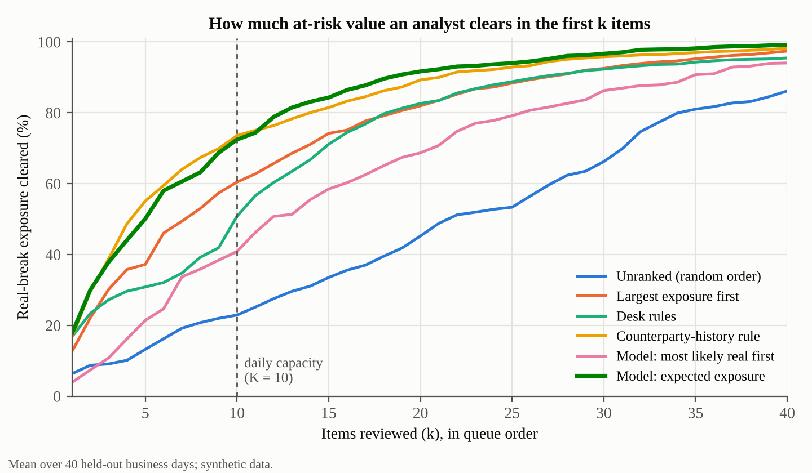
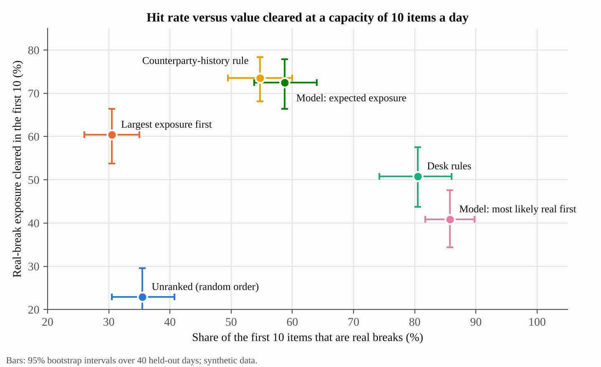
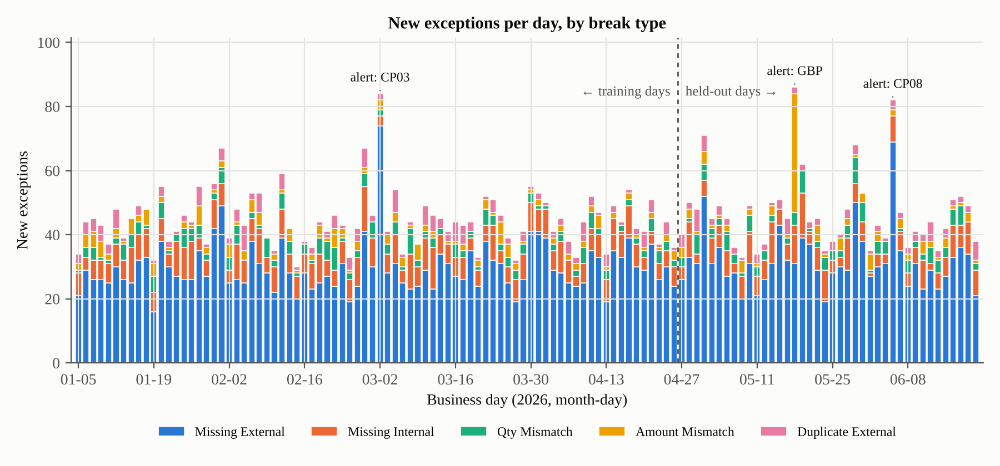
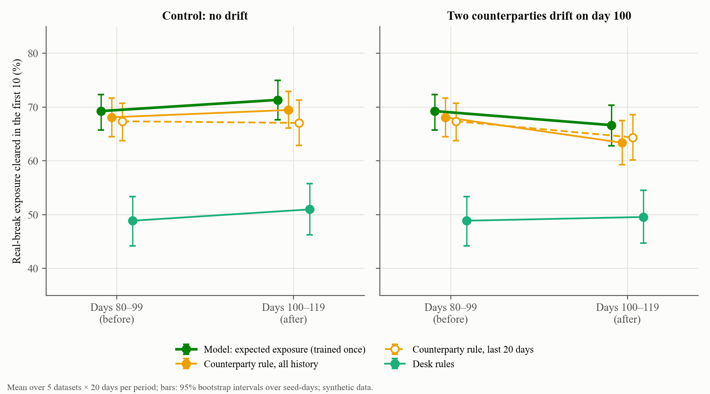

# recon-break-detector

Finds reconciliation breaks between a firm's books and its custodian's statements, then ranks
each morning's exceptions so an analyst works the ones with real money at risk first.

On 40 held-out business days of synthetic custody data, ordering the queue by **expected
exposure** clears **72% of at-risk value in the first 10 items**. A typical desk rule clears
**51%**, and sorting by size alone clears 60%. The model is better than the desk rule by +21.6
points (95% CI +14.4 to +28.9, better on 35 of 40 days).

The main finding is about the framing, not the model. A one-line rule that uses the same
counterparty history does about as well: 74% on this dataset, and within a few points of the
gradient-boosted model on all five datasets tested. The gain comes from two choices: ranking by
expected exposure instead of by type or size, and learning which counterparties post late. If I
were shipping this, the rule would go first and the model would have to earn its place. When
two counterparties change behaviour part-way through, the model's lead grows to about 3 points,
still not clearly above zero ([Under drift](#under-drift)).



## The problem

**User.** A reconciliation analyst at a custodian or asset servicer. Every morning the matcher
leaves 30 to 90 new exceptions (47 on an average held-out day here): trades booked internally
with no custodian movement, custodian movements nobody booked, partial deliveries, wrong
amounts and duplicates.

**Pain.** About two thirds of those exceptions are noise. Most "missing" items are late
postings that clear on their own within two business days. The breaks that need action, and
the ones with the most money behind them, are mixed in with the noise, and there is time to
investigate perhaps ten items properly before the cut-off.

**Goal metric.** Share of the day's real-break exposure (USD) cleared within the analyst's
capacity of 10 items. Exposure is the full notional for a missing or duplicated movement, and
only the disputed part (the quantity shortfall or the amount difference) for a mismatch.

**Guardrails.** Pair precision (a wrong match hides a break, so it must stay at 100%), the share
of the first 10 items that are real breaks, and false incident alerts.

**Not in scope.** Closing breaks automatically. The system orders the queue and explains each
item; a person decides. The one-page brief is in [docs/product_brief.md](docs/product_brief.md).

## What it does

```
 internal book ─┐                                 ┌─> ranked queue + plain-English reason ─> analyst
                ├─> matcher ─> exceptions ─> triage
 custodian    ──┘   (reference,     │        (P(needs action) x exposure)
 statement          attributes,     │
                    tolerance)      └─> surveillance ─> incident alert ("CP08 feed is late today")
```

1. **Matcher** ([match.py](src/recon/match.py)). Replays business days in order. It pairs lines
   by normalised trade reference (`REF-T00001234`, `t00001234` and `1234/1` all mean trade
   1234) when account, ISIN, side and currency agree. Lines with no reference fall back to
   account, ISIN, side, quantity and amount. Each pair is classified as matched, quantity break
   or amount break. Tolerance is set in USD, so a few yen of rounding is not a break. Unpaired
   items become exceptions that age until they clear or someone acts.
2. **Triage** ([triage.py](src/recon/triage.py)). Estimates P(needs action) for each new
   exception and orders the queue by P x exposure. Two estimators are compared: a
   gradient-boosted classifier, and a one-line rule that reads P off the counterparty's history.
   The history features only use exceptions raised at least three business days earlier, by
   which time a late posting would have cleared.
3. **Surveillance** ([surveil.py](src/recon/surveil.py)). Flags a counterparty or market whose
   exception count jumps far above its own recent median (robust z-score). A late feed or a
   stale price file then shows up as one incident instead of fifty queue items.
4. **Reasons** ([explain.py](src/recon/explain.py)). Each queue item gets a deterministic
   one-line reason. An optional language-model rewrite is shown only if it passes a check (see
   Design choices); otherwise the template is kept.

## Results

Held-out days run from 2026-04-27 to 2026-06-19: 40 days, 1,876 exceptions, 35% needing action.
The model was trained on exceptions raised up to 2026-04-21, leaving a three-day gap so no
training label comes from an outcome that was still unknown on the first test day. Intervals
are 95% bootstrap over days. Source: [results/metrics.json](results/metrics.json), generator
seed 7.

| Queue order | Real breaks in first 10 | At-risk value cleared in first 10 | Items to clear 90% of value |
|---|---|---|---|
| Unranked (random) | 36% (30–41) | 23% (17–30) | 39.1 (35.9–42.7) |
| Largest exposure first | 31% (26–35) | 60% (54–66) | 24.5 (21.9–27.8) |
| Desk rules: mismatches and duplicates first, then by exposure | 80% (74–86) | 51% (44–57) | 25.5 (22.1–29.6) |
| **Counterparty-history rule**: exposure x (1 − counterparty's self-clear rate) | 55% (50–60) | **74% (68–78)** | **19.4 (16.6–22.7)** |
| Model, most likely real first | 86% (82–90) | 41% (34–48) | 28.3 (25.0–31.8) |
| **Model, expected exposure** | 59% (54–64) | **72% (66–78)** | **18.0 (15.7–20.4)** |

**Model against each alternative** (same days, value cleared in first 10): +12.0 points over
largest exposure (CI +6.0 to +17.5), +21.6 over desk rules (CI +14.4 to +28.9), and −1.1 against
the counterparty-history rule (CI −5.7 to +2.9). That last difference is not distinguishable from
zero.

**Five datasets** ([results/robustness_by_seed.csv](results/robustness_by_seed.csv)). These use
different random seeds with the same configuration and incident schedule. Value cleared in the
first 10 ranges from 68–73% for the model, 64–74% for the counterparty rule, 48–52% for desk
rules and 35–61% for largest exposure. The model minus the rule comes to −1.1, −1.5, +6.5, +0.7
and +3.0 points.

**Hit rate against value is a product decision.** Ordering by probability alone gives the
highest hit rate (86%), because mismatches and duplicates are certain but usually small.
Ordering by expected exposure clears far more money, at the cost of spending some slots on
large "missing" items that turn out to be late postings. Which to ship depends on what the desk
is measured on.



**Matching** (all 120 days). 59,464 pairs were made, none joining the wrong trades, and 99.96% of
two-sided trades were paired. All 1,847 real breaks are flagged, 98.6% with the right type. The
26 misses are mismatches whose custodian line had no reference. They cannot be paired safely,
so they appear as one missing item on each side. No harmless trade is left open at the end.

**Model quality.** ROC AUC is 0.88 on held-out exceptions and 0.75 on the hard subset, the
"missing" items, where 21% need action.

**Surveillance.** All three injected incidents are flagged on the day they happen (two late
counterparty feeds and one stale GBP price file), with no false alerts on this dataset. Across
the five datasets there are 0 to 5 false alerts per 100 monitored days, 9 in total. About half
fall at month end, when slow-posting counterparties bunch up.



A typical day's queue with its reasons is in [results/sample_queue.md](results/sample_queue.md).
It shows the day whose model result is closest to the median.

## Under drift

The rule and the model both lean on how often each counterparty's missing items clear on their
own. So what happens when a counterparty changes behaviour? In this test
([drift.py](src/recon/drift.py)) two counterparties change on day 100, halfway through the
held-out days. Both are picked by rule, so each dataset drifts its own pair:

- the busiest counterparty outside the three slow posters starts posting late (rate 0.18, up
  from 0.02–0.04);
- the busiest of the three slow posters gets fast (rate 0.02, down from 0.12–0.20).

The model is still trained once, on pre-drift days. A control run uses the same five datasets
with no drift. Days 80–99 are identical in both runs. The table shows the share of at-risk
value cleared in the first 10, averaged over 5 datasets × 20 days per period, with 95%
bootstrap intervals over seed-days. Pooling five datasets puts the model at 69% before the
drift, against 72% for the single dataset in Results.

| Queue order | Days 80–99 (before) | Days 100–119, no drift | Days 100–119, drift |
|---|---|---|---|
| Model, expected exposure (trained once) | 69% (66–72) | 71% (68–75) | 67% (63–70) |
| Counterparty rule, all history | 68% (64–72) | 69% (66–73) | 63% (59–68) |
| Counterparty rule, last 20 business days | 67% (64–71) | 67% (63–71) | 64% (60–69) |
| Desk rules | 49% (44–53) | 51% (46–56) | 50% (45–55) |

**Model minus the all-history rule** (same days): +1.1 points before the drift (CI −1.8 to
+3.9), +1.9 after day 100 with no drift (CI −1.0 to +4.6), and +3.3 after the drift (CI −0.1 to
+6.5, model ahead on 59 of 100 seed-days and behind on 32). Against the 20-day rule after the
drift it is +2.3 (CI −0.8 to +5.5). On the five datasets separately, model minus the
all-history rule after the drift is +1.0, +6.1, −3.2, +8.4 and +4.0 points.

**The model does not clearly beat the rule under drift.** Its lead grows from 1–2 points to
about 3, but the interval still touches zero and the rule wins on one of the five datasets.
Every ordering that uses counterparty history loses a few points. Desk rules use no history and
do not move.

**Why the model holds up a little better.** Almost all the damage comes from the counterparty
that turns slow. After day 100 only 5% of its missing items are real breaks. The all-history rule
still prices them at 20%, so its large late postings keep taking queue slots, and the 20-day rule
gets down to 14%. The model was never retrained, yet it says 8%. One of its features counts
each counterparty's missing items that day, and that count jumps as soon as the counterparty
slows. The slow poster that turns fast matters much less, because most of its few remaining
missing items still clear on their own.

**A shorter memory is not a free fix.** The 20-day rule follows the new rate: by the last day
it puts seed 7's newly slow counterparty at 0.89 against a true self-clear share of 0.91, where
the all-history rule says 0.75. But it is noisier. With no drift it trails the all-history rule
by 2.4 points after day 100, and the model beats it by 4.3 (CI +1.2 to +7.6).

**What this changes.** I would still ship the rule first, but I would give it a same-day burst
signal and monitor each counterparty's self-clear rate against its history. That is the part of
the model that helped here. The test covers one kind of shift, designed by me.



`recon drift` (about a minute) writes [results/drift/metrics.json](results/drift/metrics.json),
one daily CSV per dataset and the figure.

## Quick start

```bash
git clone https://github.com/ErfanMoheb/recon-break-detector.git
cd recon-break-detector
python -m venv .venv && source .venv/bin/activate
pip install -e ".[dev]"

recon demo         # data, evaluation, figures, five-dataset check (about a minute)
pytest             # 66 tests
recon queue        # a typical held-out day's ranked queue with reasons
recon drift        # the drift test: two counterparties change behaviour on day 100
```

`recon demo` reproduces every number above. Its first line of output should read
`value cleared in first 10: model 72%, counterparty_rule 74%, largest_exposure 60%, desk_rules 51%`.
It was tested with Python 3.13, numpy 2.5, pandas 3.0 and scikit-learn 1.9; other versions may
move the model's numbers slightly.

Language-model reasons are optional:

```bash
pip install -e ".[llm]"
export ANTHROPIC_API_KEY=...
recon queue --llm    # each line is tagged [llm] or [template]
```

## Design choices

- **No ground truth in the matcher.** The generator writes truth into `truth_*` columns. The
  matcher drops them on entry, and a test shuffles them to prove the output does not change.
- **Strict time split.** Training labels stop three business days before the first test day,
  and history features are revealed with the same delay. A test rewrites recent outcomes and
  checks that the features for the day being scored do not change.
- **Uncertainty, not single numbers.** Every headline figure has a bootstrap interval over days,
  paired comparisons on the same days, and a five-dataset check.
- **A checked language model.** The check is lexical. It confirms that every identifier, date
  and figure is copied from the break's facts, that side, currency and break-type words agree
  with them, and that the text does not advise dismissing the item. It cannot confirm that a
  copied figure is given the right role, for example booked and custodian amounts swapped. A
  test marks that gap explicitly.

## Data

Everything is synthetic, generated by [generate.py](src/recon/generate.py): 8 accounts, 300
securities with valid ISINs across five markets, 15 counterparties, and about 500 trades a day
for 120 business days. Real breaks (missing movements, partial deliveries, wrong amounts,
duplicates) are injected alongside benign noise: reference formatting, blank references,
rounding inside tolerance, and late postings that clear on their own. How often a trade posts
late depends on the counterparty, the market (Tokyo and Hong Kong settle overnight for a New
York team) and month end.

## Limits

- **The result is partly built in.** I wrote the generator, and three counterparties are set to
  post late far more often than the rest. The triage gain depends on that kind of stable,
  uneven late-posting behaviour, and it is untested on real data.
- **It shows the method, not real-world performance.** A real custodian's break mix will
  differ.
- **The setup is simplified.** FX is constant, there are no market holidays, and there is one
  custodian with one statement per day.
- **Blank-reference mismatches are split.** A mismatch with no reference cannot be paired, so it
  shows up as two missing items.
- **Surveillance ignores seasonality.** Month ends can trigger alerts. On two of the five
  datasets, fewer than 3 in 4 alerts were real incidents, which misses the target in the brief.
- **The model is trained once.** There is no retraining schedule or drift monitoring. The
  drift test covers one shift that I designed (two counterparties change late-posting rates).

## What I would measure in production

- Share of at-risk value cleared before cut-off, and time to resolution per break type.
- False matches, found through analyst overrides (target: zero).
- How often analysts work items out of queue order, which shows where the ranking is wrong.
- Precision of incident alerts, and how many queue items each alert absorbs.
- Drift in per-counterparty self-clear rates, since both the rule and the model rely on them.

## Context

BNY has described AI agents working alongside its operations staff on reconciliation and
anomaly detection
([Microsoft WorkLab, 2026](https://www.microsoft.com/en-us/worklab/the-making-of-a-frontier-firm-how-ai-is-redesigning-work-at-bny)).
This project is an independent, open-source take on that problem with synthetic data. It uses
no proprietary data or code.

## Repository layout

| Path | Contents |
|---|---|
| `src/recon/generate.py` | Synthetic ledgers with labelled breaks and incidents |
| `src/recon/match.py` | Daily matcher and break classification |
| `src/recon/triage.py` | Features, model and ranking strategies |
| `src/recon/surveil.py` | Incident detection |
| `src/recon/explain.py` | Reasons and the language-model check |
| `src/recon/evaluate.py` | Evaluation against ground truth |
| `src/recon/drift.py` | Drift test: model against rules when counterparties change |
| `results/` | Metrics, figures and a sample queue produced by `recon demo` |
| `results/drift/` | Drift test outputs produced by `recon drift` |
| `docs/product_brief.md` | One-page product brief |
| `tests/` | Matcher scenarios, leakage checks, explanation checks, end-to-end run |

## Author

Erfan Mohebolkhames, PhD candidate, City College of New York.
[LinkedIn](https://www.linkedin.com/in/erfan-mohebolkhames/) ·
[Google Scholar](https://scholar.google.com/citations?user=gKwjPHgAAAAJ)

MIT licence.
